# Settlement Stream: production design

```
                     credit after broker ack                 key = merchant_id, 64 partitions
 gateway ──BOSP──▶ reader ×2 (1 leader) ──acks=all──▶ Redpanda ──offset after COMMIT──▶ consumer ×N
 (16 client_ids)   Postgres lease + epoch fence                                           │ one txn per batch:
                                                                                          ▼ dedupe + effect + checkpoint
 bank ◀──Idempotency-Key, intent committed before POST── executor ×N ◀──SKIP LOCKED── PostgreSQL ──▶ read API
   ▲                                                         │
   └──────── 50 req/s, 2 in flight/account ─── Redis (rate limiter only; wipe-safe)
```
Production sizing shown; the harness runs 12 partitions and one `client_id`. Prometheus, Loki/Alloy and Grafana (Step 9, D28–D32) scrape every service's `/metrics` and logs (not drawn).

One reader per `client_id` holds the BOSP session and publishes every frame, keyed by merchant, stamped with `session_epoch`. Consumers apply each poll batch in one PostgreSQL transaction. Executors lease payout rows and pay with a persisted idempotency key. Correctness lives only in PostgreSQL; Redis holds only the rate limiter.

**Number sources.** **[m]** measured on our stack (run cited); **[d]** derived, working shown; **[b]** from ASSIGNMENT §2.

| Key number | Value |
|---|---|
| Reader, one session → broker | 8,477 msg/s; go-back-N waste 24.6 % [m, STEP2] |
| Failover: `kill -9` / `SIGSTOP` 45 s | new session 8.6–10.8 s after `kill -9`; takeover 8.1–10.6 s after `SIGSTOP` (idle → loaded runs) vs 15 s (A1) and 30 s [b] [m, `faults.sh`: STEP2, milestone 2, S1] |
| Apply ceiling per partition | 1,500–1,700 ev/s at batch 200; 1,700–2,200 at batch 500 [m, M4] |
| Hottest merchant at 30 k/s (Zipf 0.9, 60 k) | 4.85 % = 1,455 ev/s; top 1 % = 46 % [d, M3] |
| WAL per applied event | 1,336–1,365 B; plan with 2 KB [m, M1] |
| Storage per event, all tables | ≈ 450 B (history 174 B, dedupe 178 B) [m, M2] |
| `as_of` | `Limit → Index Scan`, 0.05–0.08 ms at 2 M rows; HTTP p99 6.2 ms [m, STEP4, milestone 1] |
| End-to-end, chaos on | milestone 1: 500 k frames, `verify.py` **PASS** (6/6), 1,015 payouts each executed once; S1: 2 M frames @ 3,000/s with 8 faults, PASS, 3,881 paid each once; S2 gateway chaos: PASS [m, STEP5, STEP8] |

---

## 1. Delivery semantics, hop by hop

Every hop may deliver twice. The next hop turns the second delivery into a no-op.

| Hop | Semantics | Mechanism and key | Written when, relative to the effect |
|---|---|---|---|
| gateway → reader | effectively-once processing | per-channel `seq`. `seq < expected` is dropped whatever `poss_dup` says. A gap sends one `RESEND`, asked again after 2 s (`reader/domain/sequencer.py`, D13). Resume = `channel_progress.last_seq` on **every** logon (D14) | the resume point is the consumer-written checkpoint: only what is already **applied** |
| reader → broker | at-least-once | `acks=all`, idempotent producer (`redpanda_producer.py:20–21`); key = merchant (D1); `session_epoch` on every message (D16); a delivery error is session-fatal and the producer is recreated (D15, D19) | credit is granted only while broker-unacked frames stay under the caps (2,000 per channel, 50,000 total; `sequencer.py:194–195`); only the broker ack lowers `unacked` (`:165–173`) |
| broker → consumer | at-least-once | manual commit of `(partition, offset)` | offset committed **after the Postgres `COMMIT` returns** (`consumer/app.py:91` after `:90`/`:104`; `asynchronous=False`, `redpanda_consumer.py:44`) |
| consumer → Postgres | **exactly-once effect** | one txn per poll batch per partition (D4): `processed_events` PK `ON CONFLICT DO NOTHING` (`pg_ledger_store.py:146`); contiguity CAS `UPDATE channel_progress … WHERE last_seq = orig` (`:271–279`); stale epoch skipped (D21); out of order skipped and its dedupe row removed (D18, D22) | dedupe row, ledger effect, `ledger_history` row and checkpoint in **one transaction** |
| Postgres → executor → bank | exactly-once money movement | lease via `FOR UPDATE SKIP LOCKED`; CAS writes on `(status, attempt, lease_owner)`; `Idempotency-Key = {payout_id}#a{attempt}`, the same key while fresh, a search before any new key (D24, D25) | intent (`in_flight`, key, `pending_send_at`) committed **before the POST** (`executor/app.py:209–221`); outcome committed after the reply |

**A delivered and credited frame is never lost (§2 Availability).** Credit bounds how many frames are unpublished at once; it doesn't decide durability. `last_seq` moves only in the consumer's apply transaction. Received-not-acked when the reader dies → above `last_seq` → re-requested on resume, replayed from the gateway's 72 h history. Acked-not-applied → in the topic (`acks=all`). Missing → the contiguity CAS stalls the channel; never skipped.

The balance is deducted **once**, by the consumer, in the transaction that inserts the `payouts` row. Executors never touch balances.

## 2. Fencing

The bound on takeover is lease TTL 10 s + standby poll 1 s + logon. Measured: **8.6–10.8 s** after `kill -9`, **8.1–10.6 s** after `SIGSTOP` (idle Step 2 runs → loaded milestone 2 / S1). The old leader stepped down **0.2 s** after waking [m, `scripts/faults.sh`].

### 2a. What each process does, and what stops corruption at which hop

| t | Old leader L (epoch E) | Standby S | Stopped at hop |
|---|---|---|---|
| 0 | frozen, holding unpublished frames and a producer buffer | polls the lease every 1 s | — |
| 5 s | silent | — | **gateway:** drops L after 2.5 × heartbeat (`gateway.py:286`) |
| 10 s | lease expires (DB clock, `pg_lock.py:12–17`) | acquires; `LOGON` → **E+1**; `fence.claim(E+1)` | **gateway:** a newer logon supersedes older sessions (`gateway.py:380–385`) |
| 45 s | wakes to socket EOF; `renew` → `LOST` (`reader/app.py:259–271`); lease re-checked before any reconnect (`app.py:113–126`) | leading | **reader:** L can't reconnect over S |
| 45 s+ | its producer may flush the t=0 buffer, stamped **E** | — | **consumer:** `E < fence` → `stale_epoch` skip (D21). Even unfenced, each event is a PK duplicate or fails the contiguity CAS |

### 2b. The fencing token and who checks it

The token is the gateway's `session_epoch`, which increases strictly on every logon (`gateway.py:381`).

| Checker | Check |
|---|---|
| gateway | a newer `LOGON` closes the older session |
| reader, at logon | `UPDATE session_lease … WHERE epoch < :e` (`pg_fence.py:6–9`); 0 rows → step down |
| consumer, every batch | `msg.session_epoch < session_lease.epoch` → skip (`pg_ledger_store.py:169`; fence cached ≤ 2 s) |
| checkpoint row | `channel_progress` advances only if `seq == last_seq + 1` and `msg.session_epoch >= stored epoch` (`pg_ledger_store.py:204`), written back with a CAS on the original `last_seq` (`:271`) |

### 2c. Why a lock with a TTL is not sufficient on its own

A paused process can't see its lease expire and acts on stale belief on waking, so the lock only decides who *tries* to log on (D12); 2b provides the safety. Two real failures:
- **Incumbent.** It renewed with an unconditional `pexpire` (`incumbent/leader.py:34–37`) and carried no epoch. A woken leader extended the new leader's lock, and both logged "session up" (REVIEW L1/L2).
- **Ours, found by fault testing.** The holder id was `hostname:pid`. A restarted container got the same pair and re-entered its dead predecessor's still-valid lease. Fixed with a per-process nonce (`common/config.py:76`).

## 3. Backpressure: 30 k/s in, broker at 10 k/s for 10 min

The deficit is (30,000 − 10,000) × 600 s = **12 M frames** [d].

### 3a. Where the backlog lives, and what bounds memory

**At the gateway.** Delivery raises `unacked`; only the broker-ack callback lowers it (`sequencer.py:165–173`). `tick` grants credit only while `unacked < 2,000` per channel and `< 50,000` in total (`:194–195`). When the broker slows, credit stops, and the 12 M frames wait in the gateway's 72 h history. A channel with an open gap still gets 64 credits so its resend can arrive (D17).

| Process | Memory bound |
|---|---|
| reader | 50,000 unacked frames ≈ 14 MB (282 B per encoded message, measured over 10,000 generator frames). **Doesn't scale as configured:** granted-but-unused credit (≤ 1,000 per channel) is 0.2 M frames at 200 channels but would be 60 M at 60 k. `high_water` must come from a global credit budget split by channel rate |
| reader's producer queue | on `BufferError`: poll and retry ≤ 100 × 10 ms (`redpanda_producer.py:33–40`), then session-fatal. The reader slows; it never grows |
| consumer | one poll: ≤ 200 records in total across its partitions, grouped by partition after (`consumer/app.py:24, 81`) |
| broker | only what it accepted; retention sized for a 10-min consumer outage: 18 M msgs × 282 B ≈ 5 GB (before lz4) × RF 3 ≈ 15 GB |

**Catch-up:** 2 sessions (50 k/s) − 30 k/s arrivals = 20 k/s surplus → **12 M ≈ 10 min** at full efficiency. The measured 24.6 % go-back-N waste spends session bandwidth: useful rate 50 k / 1.246 ≈ 40 k/s, surplus ≈ 10 k/s → **≈ 20 min** [d]; consumers (64 × 1,500 ≈ 96 k/s) aren't the limit.

### 3b. How credit flow control participates

Credit tracks broker progress, not receipt: a slow broker becomes a gateway that sends less, so the backlog sits where 72 h of it is held anyway.

## 4. Partitioning and skew

| Question | Answer | Working / mechanism |
|---|---|---|
| Partition count | **64** | 30,000 ÷ 1,500 = 20 needed at batch 200 (14 at batch 500) [d, M4]. ×3 headroom for hash imbalance; a power of two; up to 64 consumers |
| Key | `merchant_id` (= channel) | Per-merchant order is a correctness requirement: CAPTURE needs its AUTH open, REFUND its CAPTURE, PAYOUT_REQUEST the `available` left by every earlier event (`rules.py`, which mirrors `apply_event` L165–215). One key → one partition → one consumer → log order (D1) |
| Hottest merchant | **1,455 ev/s** at peak | 30,000 × 4.85 % [d, M3]. Hashed, it shares a partition with ~1/64 of the rest (~450 ev/s): **~1,900 ev/s > 1,500** at batch 200 |
| Mitigation | **Pin the top 32 merchants** to their own partitions, batch 500 | `hot_merchants → partition` table (7-day volume); the rest hash over 32. Top merchant: 1,455 of 1,700–2,200 [m, M4] |
| One merchant exceeds a partition's **or worker's** throughput | Same limit (one worker per partition); lag grows on that partition only | `consumer_partition_lag` alerts; backlog waits in the broker (§3). **Never split a merchant** (breaks order): faster consumer, or absorb the peak and catch up off-peak |

**Beyond one 25 k frames/s session** (designed, not built; the harness gives one `client_id`). 30,000 > 25,000 [b], so at least 2 sessions; we plan for all 16 `client_id`s (≈ 1,900 frames/s each at peak).

| Concern | Mechanism |
|---|---|
| Channel → `client_id` | Rendezvous hash of `merchant_id` over the 16 ids (adding an id moves ~1/16 of channels), stored as `channel_owner(channel, client_id, version)`; each LOGON subscribes to its own subset |
| One session per `client_id` | One leader lock per id: `leader_lock.name = client_id` (the table is already keyed by `name`, D12), plus a reader pair per id |
| Fencing per `client_id` | `session_lease` gets keyed by `client_id` (it is a single row today), and messages carry `client_id` (`LedgerMessage` v2, D16) so D21 compares against the right row |
| Planned reassignment, without two owners | bump `channel_owner.version`, mark `draining`; old session stops granting CREDIT and drains to `last_seq`; flip owner; new session LOGONs with `resume = last_seq` (D14). Overlap is harmless: the contiguity CAS accepts each seq once |
| **Reassignment on failure** | Channels **don't move** when a reader dies. The same `client_id`'s standby takes over in 8.1–10.8 s with a larger epoch (§2). Only if every replica of an id stays down past an SLA (e.g. 60 s) does a coordinator bump the version and move its channels. The dead id's lease has expired and its epoch is stale, so it can't still own them |

## 5. PostgreSQL at 3 B rows

Sized at the brief's 3 B rows ≈ **36 M rows per month** over 84 months [d]. A note at the end covers the brief's own event rate.

### 5.1 Schema, partitioning strategy and keys

| Table | Size | Partitioning | Keys / indexes |
|---|---|---|---|
| `ledger_history` (balance after each event, D8) | 36 M/month; ≈ 0.5 TB at 3 B × 170 B [d, M2] | RANGE (`event_time`) monthly → 84 online; old months detached to cheaper storage | PK `(merchant_id, seq, event_time)` (proposed for partitioning; today `(merchant_id, seq)`); local index `(merchant_id, event_time DESC)` |
| `merchant_month_open` (new) | 60 k/month | monthly | PK `(merchant_id, month)`: opening balance, so `as_of` never walks back across partitions |
| `processed_events` | 15 M/day; ≈ 19 GB over 7 days [d, M2] | RANGE (`applied_at`) daily, drop after 7 days | PK `(event_id, applied_at)` (proposed; today `event_id`) is per-partition; the cross-day duplicate guard is the contiguity check on `channel_progress` (`seq ≤ last_seq` → duplicate; D3, D4) |
| `merchants`, `channel_progress`, `platform_fees`, `payouts` | 60 k / 60 k / 64 × currencies / 40 k a day | none (`payouts` goes monthly past 100 M rows) | small, hot, updated in place |

### 5.2 The index for an exact `as_of` in < 200 ms, and its write cost

**Query:** `WHERE merchant_id = $1 AND event_time <= $2 ORDER BY event_time DESC LIMIT 1` (`pg_read_store.py`). Pruning picks the month of `$2`. If the merchant has no row in that month, one PK lookup in `merchant_month_open` answers. That is at most 2 index descents.
**Measured** at 2 M rows: `Limit → Index Scan using ix_ledger_history_merchant_time`, 0.05–0.08 ms execution [m, STEP4]. **At 36 M rows per partition** the B-tree grows from 3 to 4 levels: under 1 ms warm, a few ms cold. That is far inside 200 ms at any instant in 7 years.
**Write cost:** one extra B-tree insert per event, **97 B of index per row** (PK plus `as_of` index) against 77 B of heap [m, M2]. Per merchant the keys arrive in time order, so inserts hit the right-most leaf pages and rarely split.

### 5.3 Update-heavy rows: HOT, vacuum, bloat, contention at 30 k ev/s

| Row | Update pattern | Contention | Bloat control |
|---|---|---|---|
| `merchants` (running balances) | once per batch per merchant | **none**: a merchant lives in one partition, so it has one writer | no indexed column changes, so updates are **HOT**-eligible. Production settings to add: `fillfactor = 70`, `autovacuum_vacuum_scale_factor = 0.01` (not set in this repo) |
| `channel_progress` | once per batch per channel (CAS) | none | HOT-eligible, same production settings |
| `platform_fees` | once per batch per currency | **none: sharded `(currency, shard = partition)`** (D9) | 64 × currencies rows |
| `payouts` | 3–6 transitions per payout | each row is owned by one executor lease (D27) | partial index `ix_payouts_claimable` keeps terminal rows out of the hot index |

Contention at 30 k ev/s is zero by construction: every merchant, channel and fee shard has one writer, and a batch makes one update per merchant.

### 5.4 Estimated WAL volume per day

Measured **1,336–1,365 B of WAL per applied event**, using `pg_wal_lsn_diff` on an isolated instance with our flags [m, M1]. That gives **≈ 20.5 GB/day** at 15 M events/day and **≈ 41 MB/s** at the 30 k/s peak [d]. At 3 B rows more full-page images follow each checkpoint, so we plan with 2 KB: **30 GB/day, 60 MB/s**. `wal_compression = on`.

### 5.5 `synchronous_commit` and fsync

Both are **on**. The broker offset is committed after the Postgres commit (D4): a lost acknowledged commit would leave the offset saying "done" and a silent hole in the ledger. Batching makes fsync cost per ~200 events, so durability isn't traded for throughput. In production: one synchronous standby (`ANY 1 (…)`) (§8).

### 5.6 Connection pooling mode, and what it forbids

Direct connections, small per-process pools: ~56 steady, 74 max at the default replicas (reader 2+1, consumer 2+1, executor threads+2 (+2), API 8+8 async); each extra consumer adds 3, against `max_connections = 200`. If a pooler is needed: PgBouncer **session mode**. Transaction mode forbids:

| Forbidden in transaction mode | Breaks | Incumbent defect |
|---|---|---|
| session-level advisory locks | lock and unlock land on different server connections | **P7** (`payouts.py:51–57`) |
| `SET` without `LOCAL` (e.g. `statement_timeout`) | applies to a random server connection | **C13** (`ledger_consumer.py:30`) |
| prepared statements across transactions; `LISTEN`, temp tables, `WITH HOLD` cursors | that state is lost between transactions | — |

Our row locks live inside one transaction; keep it that way.

> **Note: the brief's 3 B vs its own event rate.** 450 M events a month × 84 months is **37.8 B events**. We write one history row per DATA frame, which is **≈ 36 B rows ≈ 6.1 TB** [d, M2] (6.4 TB if every frame wrote a row), 12× the brief's 3 B. `as_of` still holds: about 430 M rows per partition is still 4 B-tree levels. Storage is what changes.
>
> | Option | Rows in 7 y | Cost |
> |---|---|---|
> | A. A row per DATA event (current) | ~36 B | 6.1 TB of history |
> | B. A row only when a balance changes | fewer; skips rejected and ignored events | measure the share from `processed_events.outcome` (the generator rejects a few %) |
> | C. A per-merchant snapshot every hour **or** every 1,000 events, then replay from the snapshot | **≈ 3.7 B** (≈ the brief's 3 B); events in cold storage | replay ≤ 1,000 rows inside the p99. An hourly-only snapshot wouldn't bound the hot merchant (≈ 700 k events/h) |
>
> We keep A (exact, measured, simplest); C if storage binds.

## 6. Isolation levels

No code sets an isolation level, so **everything runs at READ COMMITTED**. RC is enough because every read-modify-write is either under a row lock or a compare-and-set.

| Transaction | Level | What makes RC safe |
|---|---|---|
| consumer batch (`pg_ledger_store.py`) | RC | `FOR UPDATE` on `channel_progress`, `merchants`, referenced `auths`/`captures`; contiguity CAS (else `BatchConflict`); dedupe PK |
| executor claim (`pg_payout_repo.py`) | RC | `FOR UPDATE OF p SKIP LOCKED`; predicates repeated in the locking CTE so a just-leased row is dropped on re-check (`pg_payout_repo.py:43–48`, rationale at `:20–23`) |
| executor transition / renew / release | RC | one `UPDATE … WHERE payout_id, lease_owner, status, attempt` (CAS, rowcount 1) |
| token mint, leader lock, fence | RC | single-statement CAS (`pg_token_store.py`, `pg_lock.py`, `pg_fence.py`) |
| API reads | RC | single statements, so one snapshot each |

**The anomaly if we removed one specific constraint: the mint CAS in `pg_token_store.py` `_CLAIM`** (`issued_at < now() − 5 s AND token IS NOT DISTINCT FROM :seen`, `:13–19`). Without it, two executors that both get a 401 on token T1 each mint (`token_manager.py::on_unauthorized` → `_try_mint`). A write skew at RC:

| t | Executor E1 | Executor E2 |
|---|---|---|
| 1 | 401 on T1; reads `bank_token` = T1 | |
| 2 | | 401 on T1; reads `bank_token` = T1 |
| 3 | mints T2 at the bank; writes T2 | |
| 4 | | still acting on its stale read (e.g. it waited on the rate limiter, ≥ 5 s after t3, so the bank's mint throttle doesn't stop it): mints T3, and the bank **revokes T2** (one live token per client, `bank.py:164`); writes T3 |
| 5 | every request in flight on T2 → 401; re-mint → `429 token_rate_limited` (one mint per 5 s, `bank.py:161–163`) | |

Result: revocation ping-pong. Each stale-read mint revokes the token the other executors are using, every request on it fails 401, and re-mints hit the 5 s throttle as 429s, so payouts stall each round (the incumbent's **P8**, there caused by per-process tokens). With the CAS, E1's claim at t3 set `issued_at = now()`, so E2's claim at t4 matches 0 rows (inside the 5 s interval, and once T2 is written `token IS NOT DISTINCT FROM T1` fails too); E2 re-reads the row and uses T2. The ledger's lost update is not used as the single-guard example because it would need four layered guards removed together: the dedupe insert blocking on the other transaction's row (`pg_ledger_store.py:146`), `channel_progress … FOR UPDATE` (`:153`), the in-memory contiguity rule (`:202–206`) and the write-back CAS (`:271–279`).

## 7. Payout maths and the ambiguity protocol

### 7.1 Month-end: 1.5 M payouts in 6 h, 50 req/s, 2 in flight per account

| Quantity | Value | Working |
|---|---|---|
| Arrivals during the burst | **69.4 /s** | 1,500,000 / 21,600 s |
| Service | **50 /s** (we run 45/s: a 10 % margin under the bank's sliding window, as with harness 18/20) | [b] |
| Backlog at the end of the burst | **~419 k** (~528 k at 45/s) | (69.4 − 50) × 21,600 |
| Drain time | **8.3 h** at 50/s; **9.0 h** with resends | 1.5 M / 50; 1.62 M / 50 |
| Resend overhead | ~8 % extra POSTs | `bank.py:55–57`: 3 % + 3 % + 2 % failure modes; every resend uses a rate slot (`:192`) |
| A 20-min maintenance window during the burst [b] | **+60 k** deferred, so the backlog reaches ~479 k and the drain **≈ 9.3 h** | 20 × 60 × 50 = 60 k deferred; drain 9.0 h + 0.33 h. A maintenance 503 costs no rate slot (`bank.py:175` runs before `:192`). The ≤ 2 × 16 = 32 payouts in flight when the window opens age past the 10 s safe key age, become `ambiguous`, and are settled by one search each afterwards, never by a resend |

**Who waits longest.** End-of-burst arrivals (claims are oldest-first): 419 k / 50 ≈ **2.3 h**. Then the Zipf top 1 % in the tail: 2 slots × ≈ 1.4 s each (0.9 s + 2 % × 25 s hang, `bank.py:239`) ⇒ ≤ 1.4 payouts/s per merchant, so 1,000 take **≥ 12 min**; the cap binds only in the tail (600 × 1.4/s ≫ 50/s).

**Measured, milestone 1** (fresh stack, default chaos): 1,868 payouts → 1,015 paid, 18 failed, 835 rejected; the bank ledger shows exactly one execution per paid payout (`verify.py` PASS). Bank side: 2,311 POSTs, 1,196 maintenance 503s, 33 fail-before-commit, 21 after-commit, 21 hangs, 27 idempotent replays, 22 × 429, 10 tokens. Milestone 2 (TTL 20 s, 30 s maintenance every 90 s, 10 % after-commit): searches 42, new keys 0.

### 7.2 The ambiguous-outcome protocol as a state machine (D24, `executor/domain/payout_fsm.py`)

```mermaid
stateDiagram-v2
    [*] --> accepted : consumer applies PAYOUT_REQUEST (same txn as settled -= amount)
    [*] --> rejected : insufficient funds
    accepted --> claimed : claim() SKIP LOCKED, lease 45 s
    claimed --> in_flight : COMMIT intent (key, attempt, pending_send_at), THEN POST
    in_flight --> in_flight : 401/429/503/409/connect error, or unknown & key age < 10 s → same key; wait in next_attempt_at
    in_flight --> paid : 201 or replayed 201
    in_flight --> failed : 422 account_closed (also replayed)
    in_flight --> ambiguous : unknown outcome & key age ≥ 10 s
    ambiguous --> paid : search finds a row matching amount/account/currency
    ambiguous --> ambiguous : search failed, or < 10 s since last send
    ambiguous --> in_flight : search OK and empty → attempt+1, new key
    in_flight --> stuck : 422 other than account_closed / unexpected status / a 6th key needed (attempt ≥ 5)
    ambiguous --> stuck : row mismatch
```



- **Write order** (`executor/app.py:209–221`, `_post` at `:284`): renew lease → rate slot → token → **commit intent (CAS; on failure abandon, no bank call)** → POST → record attempt → commit outcome. A successor seeing `pending_send_at` treats the outcome as unknown (`payout_fsm.py:196`). Waits go into `next_attempt_at` with the lease released. POST timeout 5 s: the bank commits before its 25 s hang, so a same-key resend gets the replay at once (`bank.py:231→239`).
- **Key policy (D25).** The key is `{payout_id}#a{attempt}`, ≤ 22 chars against the 64-char limit. The body comes only from the frozen payout row, so `idempotency_key_reused` can only mean a bug, and the payout goes to `stuck`.
  - **Reuse:** at any age until a send under it has an unknown outcome; after that only while younger than **10 s** (or ½ × a configured bank TTL; `payout_fsm.py:67–71, 130–137`). Age counts from our `key_first_sent_at`, written before the bank's clock starts, so it is never underestimated.
  - **New key:** only after a successful empty search ≥ 10 s after the last send (1.5 s processing + 3 s index lag, `bank.py:148`, + margin). A failed search never leads to a send.

### 7.3 Where a double payment can still occur, and what detects it

| Window | In `bank.py`? | In production | Detector |
|---|---|---|---|
| The bank commits an **old-key request more than 10 s after our last send**, after our search came back empty and we sent a new key | no: commit ≤ 1.5 s after receipt (`bank.py:217`) | yes: TCP or proxy delay, a starved bank thread | a reconciliation sweep over the last 15 min of `paid` payouts for > 1 bank row per reference: **designed, not built**. Live today: `bank_duplicate_reference_total` (our own search sees > 1 row), a warning log on every new-key send, and the Grafana alert rule `dup-bank-reference` that pages on it (D31) |
| The search index lags by more than 10 s | no (3 s) | possible | the same sweep; raise `PAYOUT_SEARCH_DELAY_S` |
| A payout row is lost in an async failover after it was sent | n/a | yes | the search-first rule after a failover (§8): **designed, not built** |

**Tested** (`tests/unit/executor/test_app.py`, `FakeBank` counts executions): a crash at each of 6 points, and inside a maintenance window longer than the key TTL → exactly **1** execution each; 2 executors × 200 payouts under chaos → 190 paid once, 10 closed-account with 0.

## 8. Failure modes

| Failure | What happens | What self-heals | What pages a human |
|---|---|---|---|
| **Redis lost** | Only the rate limiter uses it. A wipe or connection error switches `CompositeLimiter` to a local share (limit ÷ live executors from `executor_heartbeat`, `composite_limiter.py:63–92`), granting nothing for one window so the emptied window can't burst. Measured across a wipe: 18–21 grants/s (36 before the fix) | everything; it flips back to Redis once healthy. Leases, checkpoints, payouts and the token all live in Postgres | alert (warn) `limiter-fallback`: `limiter_fallback == 1` for > 10 min |
| **Postgres failover to an async replica** | **Lost:** all commits after the replica's replay LSN. Ledger, history, dedupe rows and `channel_progress` go **together** (one txn per batch, D4), so the session checkpoint regresses exactly as far as the ledger. Broker offsets don't. **Detect:** old primary's last flushed LSN > new primary's `pg_last_wal_replay_lsn()`; `last_seq` going backwards on `/v1/ops/status` | **Ledger + checkpoint:** reader resumes from the regressed checkpoint (D14), gateway replays (≤ 72 h), consumers re-apply cleanly (dedupe rows gone too). **Payouts:** a row with `pending_send_at` → `ambiguous` → search, never resent. A lost row returns as `accepted`/`#a1`; promotion switches executors to **search-first** for payouts newer than (failover − lag bound) (**designed, not built**: today a lost row re-sends `#a1`, which is a bank replay only within the 120 s key TTL). Exposure ≈ rate × lag (≈ 500 at month-end, 10 s lag) | **always** (a data-loss event); also if a regressed checkpoint is now older than 72 h (next row) |
| **Broker partition-leader loss** | The producer (`acks=all`, idempotent) retries for up to 30 s; past that the session is fatal, the producer is recreated and the reader reconnects from the checkpoint (D15, D19). Consumers refetch from the new leader | yes, in seconds at RF 3 | an under-replicated partition for > 5 min (production alert, not in our rule set; local Redpanda is RF 1) |
| **Checkpoint older than the 72 h replay window** | The gateway can't resend from `last_seq + 1`. That channel's resend is never answered: 30 tries × 2 s, then the session is fatal (D13), and the reconnect loops | no | immediately: `reader_resends_total{reason="timeout"}` climbing on one channel. Prevention: alert when `channel_progress.updated_at` lags 24 h (both alerts designed, not provisioned; visible on the Settlement overview resend panel). Recovery needs the acquirer's statement or bulk file |
| **Poison event** | Bad fields inside an event → `rejected:malformed_event` (`rules.py:36`) or `malformed` (`pg_ledger_store.py:189`); the seq is consumed. Undecodable bytes, or an event missing `event_id`/`type` → `malformed`, offset committed, seq **not** consumed (`pg_ledger_store.py:168, 175–176`) | bad fields: yes, the channel moves on. Undecodable / missing id or type: republished on the reader's next reconnect; if the gateway keeps resending the same bytes, **that channel stalls**; others are unaffected | `consumer_events_total{outcome="malformed"} > 0` |
| **Executor `kill -9` mid-POST** | lease expires (45 s), `pending_send_at` set → unknown outcome: same key if < 10 s old, else search | yes: 1 execution at every crash point (§7.3); observed up to 93.7 s with a maintenance window (S1) | no |
| **Bank maintenance longer than the key TTL** (20 min vs 120 s [b]) | 503 → wait in `next_attempt_at` per `Retry-After`; uncertain keys have aged out by then, so they go `ambiguous` and are searched after the window | yes (tested with a crash inside the window) | `ambiguous` rows older than 10 min after the window ends (designed, not provisioned; visible on the Settlement overview payouts panel) |

## 9. Three tradeoffs

| # | Chose | Gave up | With more time |
|---|---|---|---|
| 1 | **Go-back-N without a reorder buffer** (D13) | 24.6 % of delivered frames re-sent (20,893 / 84,921 [m]), in exchange for bounded memory and a simple state machine | a ≤ 64-frame buffer (the gateway's batch size, `gateway.py:248`) on hot channels only |
| 2 | **One transaction per poll batch per partition** (D4) | per-event isolation: a crash replays up to 200 (deduped) records, and one slow merchant delays its whole batch. Bought ~6× throughput (270 → ~1,500–1,700 ev/s per partition) with `synchronous_commit = on` | an adaptive batch size driven by `consumer_partition_lag` and `consumer_apply_seconds` |
| 3 | **10 s safe key age, and a search before any new key** (D25) | an ambiguous payout waits ≥ 10 s; searches share the 10/s budget; the late-commit window (§7.3) is narrowed, not closed | the reconciliation sweep as a real job; ask the bank for key retention longer than our retry horizon, so we'd never need a new key |

---

## Where each claim lives in code

| Decision | Files |
|---|---|
| D1 broker, key = merchant; D15/D19 producer recovery | `services/reader/adapters/redpanda_producer.py`, `services/reader/app.py` |
| D2/D12/D21 lease, epoch fence, stale-epoch skip | `services/common/adapters/pg_lock.py`, `pg_fence.py`, `services/consumer/adapters/pg_ledger_store.py` |
| D3/D14 checkpoint, resume on every logon | `services/common/adapters/pg_checkpoint.py`, `services/reader/app.py` |
| D4/D18/D22 batch apply, contiguity, out-of-order | `services/consumer/adapters/pg_ledger_store.py`, `services/consumer/app.py` |
| D8 `as_of`; D23 readiness | `services/api/adapters/pg_read_store.py`, `services/api/routes.py` |
| D9 sharded fees | `services/common/models.py` `PlatformFee`, `pg_ledger_store.py` |
| D10/D13/D17 credit, go-back-N, credit floor | `services/reader/domain/sequencer.py` |
| D16 message contract | `services/common/messages.py` |
| D24/D25/D26 payout state machine, keys, timeouts | `services/executor/domain/payout_fsm.py`, `services/executor/app.py` |
| D27 claim, D6 limiter and token | `services/executor/adapters/pg_payout_repo.py`, `composite_limiter.py`, `redis_limiter.py`, `pg_token_store.py`, `services/executor/domain/token_manager.py` |
| D11 ORM + migrations | `services/common/models.py`, `services/db/migrations/versions/` |
| D28–D32 observability | `observability/` (Prometheus, Loki, Alloy, Grafana dashboards and alert rules) |

Decisions with options and reasons: `docs/DECISIONS.md`. Measurements: `docs/design/measurements.md`.

## Known gaps

- **Reconciliation sweep for late old-key commits:** designed, not built (§7.3).
- **Messages that are undecodable, or whose event lacks `event_id`/`type`, don't consume their seq:** a gateway that keeps resending them stalls that channel (§8).
- **Search-first after a Postgres failover:** designed, not built (§8).
- **Some §8 paging conditions are not provisioned as alerts:** under-replicated partitions, resend timeouts on one channel, checkpoint age > 24 h, old `ambiguous` rows. The 7 provisioned rules are in D31.
- **Reader credit at 60 k channels:** per-channel `high_water` needs a global credit budget (§3a).
- **Multi-`client_id` operation:** `session_lease` keyed by `client_id`, `LedgerMessage` v2 and the `channel_owner` coordinator are designed, not built (§4).
- **Storage at the brief's own event rate:** ≈ 36 B history rows; snapshots (option C) are the path if storage binds (§5 note).
- **Production rate margin:** 45/s against the bank's 50/s is assumed, not measured against a production bank.
