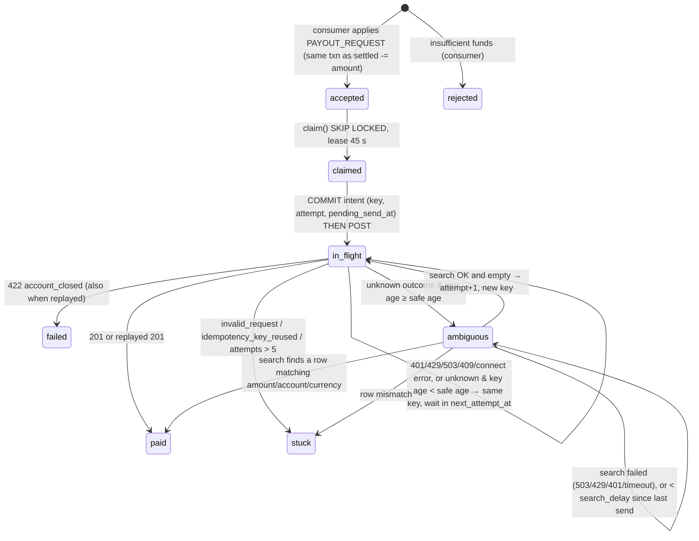

## 7. Payout maths and the ambiguity protocol

### 7.1 Month-end drain (ASSIGNMENT §2: 1.5 M payouts in 6 h, bank 50 req/s, 2 in flight per account)

| Quantity | Value | Working |
|---|---|---|
| Arrival rate during the burst | **69.4 /s** | 1,500,000 / 21,600 s |
| Service ceiling | **50 /s** (we run at 45/s: 10 % margin under a sliding window, `BANK_PAYOUT_RATE`) | §2; same margin as harness 18/20 (`docs/step5/B-limits-token.md` §2.2) |
| Backlog at the end of the burst | **~419 k** at 50/s (~518 k at 45/s) | (69.4 − 50) × 21,600 |
| Drain time, no retries | **8.3 h** at 50/s; **9.3 h** at 45/s | 1.5 M / 50; 1.5 M / 45 |
| Extra POSTs from same-key resends | **~8 %** | `bank.py:55–57`: 3 % fail-before-commit (503, key deleted → resend) + 3 % 502 after commit + 2 % hang (our 5 s timeout → resend → replay). Each resend is a POST and uses up a rate slot (`bank.py:192` runs before the idempotency lookup) |
| Drain time with resends | **9.0 h** at 50/s; **10.0 h** at 45/s | 1.62 M / 50; 1.62 M / 45. |
| One **20-min maintenance window** during the burst (§2) | **+60 k** deferred payouts, so the backlog becomes **~479 k** and the drain **+20 min → ≈ 9.3 h** (9.4 h with resends) | 20 × 60 s × 50/s = 60 k. A 503 `maintenance` costs no rate slot (`bank.py:175` runs before `:192`), so the queue simply waits. Every payout in flight when the window opens (≤ 2 × 16 = 32) has its key age past the 10 s safe age long before the window closes, so it goes `ambiguous` and is resolved by a search afterwards (32 searches ≪ 10/s), never by a resend |

**The three answers (§6.7, cap = 2 in flight per account):**
- **Drain time:** 8.3 h from the first arrival at 50/s, about 9.0 h with ~8 % same-key resends. Each 20-min maintenance window adds 20 min.
- **Backlog:** ~419 k when the 6 h burst ends, plus 60 k per maintenance window that falls inside it.
- **Merchants who wait longest:** the merchants whose requests arrive at the end of the burst, about 2.3 h each. After them, the Zipf top-1 % merchants in the tail, each with ~1,000 payouts throttled to 2 in flight (≥ 12 min each).

**Why.** Claims go oldest first, so the last arrival waits behind the whole backlog: 419 k / 50 ≈ 2.3 h. The per-account cap counts rows already leased (`pg_payout_repo.py:25–42`). A slot is occupied ≈ 1.4 s: 0.9 s mean processing (`bank.py:217`), plus 2 % × 25 s of hang, during which the bank holds the slot even after our replay (`bank.py:239`). So one merchant runs at ≤ 2 / 1.4 ≈ 1.4 payouts/s, and 1,000 payouts take ≥ 12 min. The cap only binds in the tail, because 600 hot merchants × 1.4/s ≫ 50/s.

**Search budget.** Search is 10/s (`bank.py:49`), separate from POSTs. Hangs and 502s resolve by a same-key replay, not a search. Only keys aged past the safe age (maintenance, crash) need a search: ≤ 2 × 16 = 32 per window.

Live milestone counters (fresh stack, default chaos): paid ‹M5: paid›, failed ‹M5: failed›, same-key resends answered by a replay ‹M5: replays›, searches ‹M5: searches›, new keys after an empty search ‹M5: new_keys›, double executions in the bank ledger ‹M5: 0?›.

### 7.2 State machine (D24, `services/executor/domain/payout_fsm.py`)

**The write ordering is what makes a crash safe.** In the app (`services/executor/app.py:251–300`):
1. Renew the lease.
2. Take a payout rate slot.
3. Get the shared token.
4. Commit the decision's fields, which carry the intent: `in_flight`, the key and `pending_send_at`. This is a CAS on `(payout_id, lease_owner, status, attempt)` (`app.py:367`). If the CAS fails, the row is abandoned without any bank call.
5. POST.
6. Record the attempt.
7. Commit the outcome.

If a successor sees `pending_send_at` still set, the previous owner died mid-call. It treats that as an unknown outcome (`payout_fsm.py:196`). Waits are written to `next_attempt_at` and the lease is released, so no thread sleeps while holding a lease.

### 7.3 Key policy (D25)

- **Key** = `{payout_id}#a{attempt}` (`payout_fsm.py:115`), e.g. `M-0042:1187#a1`. At 60 k merchants it stays ≤ 22 chars, well under the 64-char limit (`bank.py:183`). The request body comes only from the payout row: `amount`, `account` and `currency` are frozen at apply time (ASSIGNMENT §4). It is therefore byte-identical on every retry, so `idempotency_key_reused` can only mean a bug, and the row goes to `stuck`.
- **Reuse** (`can_reuse_key`, `payout_fsm.py:130–137`):
  - A key under which no send has had an unknown outcome is reused at any age: nothing can have been committed under it.
  - An uncertain key is reused only while younger than the **safe age**: `PAYOUT_KEY_SAFE_AGE_S`, default 10 s, capped at ½ × `BANK_IDEMPOTENCY_TTL_S` when that is configured (`payout_fsm.py:67–71`).
  - Age is measured from our `key_first_sent_at`. That is written before the bank's own `at` (`bank.py:213`, kept on completion at `:231`), so our age is never younger than the bank's.
- **A new key only after proof** (`payout_fsm.py:286–300`). An `ambiguous` row waits `search_delay` = 10 s after its last send (1.5 s max processing + 3 s index lag, `bank.py:148`, + margin). It then searches by `reference = payout_id`:
  - search failed → stay `ambiguous`, never send;
  - a matching row found → `paid`;
  - more than one row → `paid`, plus `bank_duplicate_reference_total` and a page;
  - a row with a mismatched field → `stuck`;
  - search succeeded and found nothing → `attempt + 1` and a new key.

### 7.4 Where a double payment can still happen, and what detects it

| Window | Can it happen with `bank.py`? | In production | Detector |
|---|---|---|---|
| The bank commits an **old-key request more than `search_delay` (10 s) after our last send**: our search came back empty, we sent under the new key, then the old request committed too | No: the commit is ≤ 1.5 s after receipt (`bank.py:217`) | Yes: a request held in a TCP buffer, proxy queue or starved bank thread | Reconciliation sweep over `paid` payouts from the last 15 min, alerting on more than 1 bank row per reference. It is designed but not built: today only `bank_duplicate_reference_total` (our own search seeing more than 1 row) and a warning log on every new-key send exist |
| The search index lags by more than `search_delay` | No (3 s, `bank.py:148`) | Possible | Same sweep. Mitigation: raise `PAYOUT_SEARCH_DELAY_S` |
| A payout row lost in a Postgres async failover after it was sent (§8) | n/a | Yes | Post-failover search-first rule (§8) |

**Tested** (`tests/unit/executor/test_app.py:198–300`, `FakeBank` counts executions per reference):
- **Each crash point:** after claim, after intent, during POST, after response, after `paid`, mid-search. The successor ends with **exactly 1 execution**.
- **Maintenance longer than the key TTL, with a crash:** 1 execution.
- **Two executors under chaos:** 190 of 200 paid exactly once; the 10 to closed accounts failed with 0 executions.

---

## 8. Failure modes

| Failure | What happens | What self-heals | What pages a human |
|---|---|---|---|
| **Redis lost** (`FLUSHALL` / restart without persistence) | Only the bank rate limiter uses Redis. A wipe (epoch key gone) or a connection error switches `CompositeLimiter` to a local share: limit ÷ live executors from `executor_heartbeat` (`composite_limiter.py:63–92`). It distrusts Redis for 2 s and grants nothing for one window, so the emptied window can't burst. Measured across a wipe: 18–21 grants/s (36 before the fix) | Everything: mode flips back to `redis` once it's healthy. Leader lease, checkpoints, payouts and the token are all in Postgres | `limiter_fallback == 1` for more than 10 min |
| **Postgres failover to an async replica** | **Lost:** every commit after the replica's replay LSN. That is ledger rows, `ledger_history`, `processed_events`, `channel_progress`, payout rows and payout transitions. They are lost **together**, because each consumer batch writes all of them in one transaction (D4). The session checkpoint (`channel_progress`) therefore regresses exactly as far as the ledger. Broker offsets live in Redpanda and do **not** regress. **Detect:** the old primary's last flushed LSN (from its WAL or the monitoring record) > the new primary's `pg_last_wal_replay_lsn()` at promotion. Also visible as `channel_progress.last_seq` going backwards on `/v1/ops/status` | **Ledger and checkpoint.** At its next logon the reader resumes from the regressed `channel_progress` (D14, every reconnect), the gateway replays from there (if within 72 h), and the consumers re-apply. The lost tail's `processed_events` rows are gone too, so nothing is rejected as a duplicate and re-application is clean. The topic copies past the committed offsets are never re-read; the replayed copies are new messages. **Payout rows that survived in an older state**: `pending_send_at` set → unknown outcome → key past the safe age → `ambiguous` → search → `paid`, never resent. **Payout rows lost entirely** are re-created as `accepted` with key `#a1`. To stop a second execution past the bank's 120 s TTL, promotion switches the executor to **search-first** for payouts created after (failover time − replication-lag bound): each one searches by reference before its first POST. Exposure ≈ payout rate × lag: a 10 s lag ≈ 5 payouts on a normal day, ≈ 500 at month-end | **Always**: a data-loss event. Also if any channel's regressed checkpoint is older than 72 h (can't replay; see the row below) |
| **Broker partition-leader loss** | The producer (`acks=all`, idempotent) retries for 30 s (D1). If that fails, the session is fatal, the producer is recreated and the reader reconnects from the checkpoint (D15, D19). Consumers refetch from the new leader; offsets are durable | Yes, in seconds with RF 3. In the harness (RF 1) it's a broker restart | An under-replicated partition persisting for more than 5 min |
| **Checkpoint older than the 72 h replay window** | The gateway can't resend from `last_seq + 1`. The sequencer's resend for that channel is never answered: 30 attempts × 2 s, then the session is fatal (`sequencer.py`, D13) and the reconnect loops | No | Immediately: `reader_resends_total{reason="timeout"}` climbing on one channel, plus `channel_progress.updated_at` lag. Prevention: alert at 24 h of lag. Recovery needs an acquirer statement / bulk file |
| **Poison event** | Undecodable message bytes → outcome `malformed`, offset committed, seq **not** consumed (`pg_ledger_store.py:168,176`). Decodable but malformed fields → `rejected:malformed_event` (`rules.py:36`) or `malformed` with the seq consumed (`pg_ledger_store.py:189`), plus a history row. The partition never stalls (D18) | Fields poison: yes, the channel moves on. Bytes poison: the channel's next seq waits for the reader's next reconnect to republish (D14). If the gateway resends the same poison, the channel stalls; other channels on that partition are unaffected | `consumer_events_total{outcome="malformed"} > 0` |
| **Executor `kill -9` mid-POST** | The lease expires (45 s) with the row `in_flight` and `pending_send_at` set. The successor treats the outcome as unknown: it resends the same key while it is younger than the safe age (bank replays), otherwise `ambiguous` → search | Yes: tested, exactly 1 execution at every crash point (§7.4) | No |
| **Bank maintenance longer than the key TTL** (150 s vs 120 s; reviewers: 30 s vs 20 s) | 503 `maintenance` → wait in `next_attempt_at` per `Retry-After`. A key that had an unknown send before the window has aged past the safe age → `ambiguous` → search after the window | Yes: tested with a crash inside the window, 1 execution | Only if `ambiguous` rows stay ambiguous more than 10 min after the window ends |

---

## 9. Three tradeoffs

| # | Chose | Gave up | With more time |
|---|---|---|---|
| 1 | **Go-back-N, no buffering** (D13) | 24.6 % of delivered frames re-sent (20,893 / 84,921, measured); bought bounded memory and no reorder buffer | ≤ 64-frame buffer (the gateway's batch size, `gateway.py:248`) on hot channels only, in `sequencer.py` |
| 2 | **One transaction per poll batch per partition** (D4 amended) | ~6× throughput (270 → ~1,700 ev/s per partition) with `synchronous_commit=on`. Costs: a crash replays ≤ 200 deduped records, and one slow merchant delays its batch | Adaptive batch size driven by `consumer_batch_size` / `consumer_apply_seconds` |
| 3 | **10 s safe age + search before any new key** (D25) | An ambiguous payout waits ≥ 10 s; searches share 10/s; the late-commit window (§7.4) is narrowed, not closed | A reconciliation job over recent `paid` payouts; ask the bank for key retention ≥ our retry horizon, so we never need a new key |
