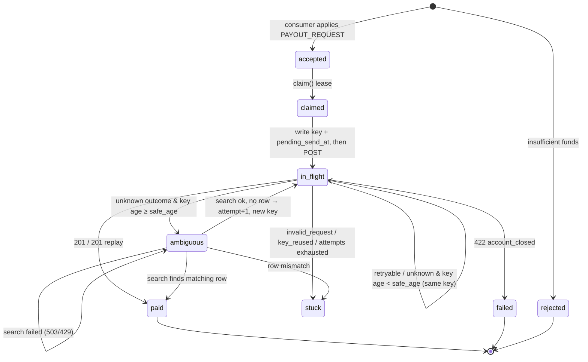

# Step 5 · A — Payout state machine and bank outcome matrix

Every bank fact below is from `harness/bank.py` (cited `bank.py:L`); where BANK-API.md disagrees, the code wins. Builds on D5 (`docs/DECISIONS.md`). Lease/claim mechanics are section C, limiter/token are section B; this section owns statuses, keys, and what each bank reply means.

## 0. Order of checks in `create_payout` (bank.py:172–243)

The order decides what a reply tells us:

| # | Check | Lines | Consequence for us |
|---|---|---|---|
| 1 | maintenance → 503 | 175–178 | before auth and before any key lookup: key state at the bank is **untouched** (it keeps ageing) |
| 2 | token → 401 | 179–180 | key untouched |
| 3 | body / key ≤ 64 chars → 422 `invalid_request` | 181–187 | key untouched |
| 4 | global rate limit → 429 | 192–194 | **before** the key lookup: a replay attempt also burns a slot and learns nothing |
| 5 | key expiry: `now − rec.at > TTL` → forget key | 196–198 | `at` is the **first** request's time and is preserved on completion (L231): TTL runs from first send, not last |
| 6 | same key, other body → 422 `idempotency_key_reused` | 200–201 | body hash = `reference, account, amount_minor, currency` (L188) |
| 7 | same key in progress → 409 `request_in_progress` | 202–203 | only during the 0.3–1.5 s processing sleep (L217); the 25 s hang happens **after** the record is `done` (L231, L239) |
| 8 | same key done → replay **with the original status code** + `Idempotent-Replayed: true` | 204–205 | replay of a commit is **201**, replay of a closed account is **422** — not 200 as BANK-API.md says |
| 9 | per-account in-flight ≥ 2 → 409 `too_many_inflight` | 206–208 | after the key lookup, so a replay is never blocked by in-flight |
| 10 | closed account → cache `done/422` with `at=now`, return 422 | 209–212 | checked before the in-progress record; terminal and replayed as 422 |
| 11 | record `in_progress`, in-flight += 1 | 213–214 | slot held until L241–243, **including the 25 s hang** |
| 12 | 3 %: 503 `upstream_unavailable`, **key deleted** | 219–223 | nothing committed; same key is a fresh request |
| 13 | commit (ledger + key `done/201`) | 224–231 | money moved |
| 14 | 3 %: 502 `bad_gateway` after commit | 232–235 | money moved, key cached as 201 |
| 15 | 2 %: hang 25 s after commit, then 201 | 236–240 | money moved, key cached; a same-key resend during the hang gets the 201 replay immediately |

Search (bank.py:139–150): maintenance 503 (L140), 401 (L142), own limit 10/s → 429 (L145), rows with `committed_at <= now − 3 s` only (L148).

## 1. Outcome matrix

`safe_age` = our key-reuse limit (§3). "Unknown" = the request may have reached the bank and committed.

| Bank behaviour | bank.py | Money moved? | Key at bank after | Our next action | Next status | Key / attempt |
|---|---|---|---|---|---|---|
| 201 (fresh) | 240 | yes | cached `done/201` | record `bank_payout_id` | `paid` | — |
| 201 + `Idempotent-Replayed` (replay of a commit, incl. one whose first reply was 502 or a hang) | 204–205 | yes, once | cached | record `bank_payout_id` from body | `paid` | — |
| 422 `account_closed` (fresh or replayed) | 209–212 / 204–205 | no | cached `done/422` | stop forever | `failed` (reason `account_closed`) | — |
| 401 `invalid_token` | 179–180 | no | untouched | refresh token (B), resend | `in_flight` | same key* |
| 409 `too_many_inflight` | 206–208 | no | untouched | wait 1 s (+jitter), resend | `in_flight` | same key* |
| 409 `request_in_progress` | 202–203 | not yet (in 0.3–1.5 s) | `in_progress` | wait 1 s, resend | `in_flight` | same key; key stays **uncertain** |
| 429 `rate_limited` | 192–194 | no | untouched | wait `Retry-After` (1 s), resend | `in_flight` | same key* |
| 503 `maintenance` | 175–178 | no | untouched (still ageing) | wait `Retry-After` (30 s), resend | `in_flight` | same key* |
| 503 `upstream_unavailable` | 219–223 | no | **deleted** | backoff, resend | `in_flight` | same key* |
| 502 `bad_gateway` | 232–235 | **yes** in this bank; treated as unknown (a real proxy 502 can be either) | cached `done/201` | resend same key within `safe_age` → 201 replay gives the id; otherwise search | `in_flight` → `ambiguous` if past `safe_age` | same key; uncertain |
| client timeout (incl. 25 s hang) | 236–239 | unknown (hang: yes) | `in_progress` or `done/201` | resend same key within `safe_age`; otherwise search | `in_flight` → `ambiguous` | same key; uncertain |
| connect error (TCP refused / connect timeout: request never sent) | — | no | untouched | backoff, resend | `in_flight` | same key* |
| read error / reset after send | — | unknown | unknown | as timeout | `in_flight` → `ambiguous` | same key; uncertain |
| 422 `idempotency_key_reused` | 200–201 | unknown for the original | cached for the original | page ops; do not send | `stuck` | — |
| 422 `invalid_request` | 183–187 | no | untouched | page ops; do not send | `stuck` | — |

\* "same key" at any age is safe **only while the key is not uncertain** (no send under this key has had an unknown outcome): then nothing was committed under it, and an expired key just makes the resend a fresh, single execution. Once uncertain, the key may be reused only below `safe_age`.

## 2. State machine

### 2.1 States

| Status | Meaning | Public (`/v1/payouts`) |
|---|---|---|
| `accepted` | written by the consumer; nothing sent | pending |
| `claimed` | leased by an executor (C); intent not yet written | pending |
| `in_flight` | intent written (key, attempt, `pending_send_at`); a POST is about to happen, is happening, or must be retried | pending |
| `ambiguous` | key is uncertain **and** older than `safe_age`; only a search may decide | pending |
| `paid` | terminal | paid |
| `failed` | terminal (`account_closed`) | failed |
| `rejected` | terminal, set by the consumer | rejected |
| **`stuck`** (new) | a reply that can only mean our bug (`invalid_request`, `idempotency_key_reused`, search row mismatch, attempts exhausted). Excluded from `claim()`, pages a human, never retried automatically | pending |

`stuck` is added because looping on a request the bank says is malformed burns the 20/s budget forever, and marking it `failed` would wrongly tell the merchant the money is gone. Needs: CHECK constraint, `PAYOUT_STATUSES`, `PAYOUT_PUBLIC_STATUS` → pending, migration.

### 2.2 New columns on `payouts`

| Column | Type | Why |
|---|---|---|
| `pending_send_at` | timestamptz null | set **before** POST, cleared after the reply is persisted. Non-null on recovery = crashed mid-call = treat as unknown outcome |
| `key_uncertain` | bool default false | sticky per key: true once any send under the current key had an unknown outcome (or crashed); reset only when the key changes |
| `last_sent_at` | timestamptz null | search must wait until `last_sent_at + search_delay` (§4) |
| `next_action_at` | timestamptz null | backoff / Retry-After / search delay; `claim()` skips rows whose time hasn't come |
| `search_attempts` | int default 0 | budget and alerting |

Existing: `idempotency_key`, `attempt`, `key_first_sent_at`, `bank_payout_id`, `reason`, `last_error`, lease fields.

### 2.3 Transitions

"Before" = committed before the HTTP call; "after" = committed after the reply.

| From | To | Guard | Persisted | When |
|---|---|---|---|---|
| `accepted` | `claimed` | `claim()` lease (C) | lease_owner, lease_until | before |
| `claimed` | `in_flight` | first send | `attempt=1`, `idempotency_key=f"{id}#a1"`, `key_first_sent_at=now`, `last_sent_at=now`, `pending_send_at=now` | **before POST (write-ahead intent)** |
| `in_flight` | `in_flight` | resend allowed (§3) | `last_sent_at=now`, `pending_send_at=now` | **before POST** |
| `in_flight` | `paid` | 201 / 201 replay | `bank_payout_id`, `pending_send_at=null` | after |
| `in_flight` | `failed` | 422 account_closed | `reason='account_closed'`, `pending_send_at=null` | after |
| `in_flight` | `in_flight` | known "not executed" reply (401, 409 inflight, 429, 503×2, connect error) | `pending_send_at=null`, `next_action_at`, `last_error` | after |
| `in_flight` | `in_flight` | unknown outcome, key age < `safe_age` | `key_uncertain=true`, `pending_send_at=null`, `next_action_at=now+1s` | after |
| `in_flight` | `ambiguous` | `key_uncertain` and key age ≥ `safe_age` | `next_action_at=last_sent_at+search_delay` | after (or on recovery) |
| `ambiguous` | `paid` | search ok, row(s) found, fields match | `bank_payout_id` (first row) | after search |
| `ambiguous` | `in_flight` | search ok, **no row**, `now ≥ last_sent_at + search_delay` | `attempt+=1`, new key, `key_first_sent_at=now`, `key_uncertain=false` → then the send transition above | before POST |
| `ambiguous` | `ambiguous` | search failed (503/429/401/timeout) | `search_attempts+=1`, `next_action_at=now+backoff` | after search |
| any non-terminal | `stuck` | invalid_request, key_reused, search row mismatch, `attempt > max_attempts` | `reason`, `last_error` | after |
| recovery: `in_flight` with `pending_send_at` set | `in_flight` / `ambiguous` | treat as unknown outcome (key_uncertain=true), then the age rule | as above | on re-claim |

Every write is a compare-and-set on `(payout_id, status, attempt)` (C's `transition()`), so a stale executor whose lease expired can't overwrite a newer decision.

### 2.4 Diagram



## 3. Key policy

- **Key** = `f"{payout_id}#a{attempt}"`. `payout_id` is the event id `M-0042:1187` (12 chars here; at 60 k merchants and 450 M events/month ≈ `M-60000:` + 10 digits = 18). With `#a99` the key is ≤ 22 chars, well under the 64-char limit (bank.py:183).
- **Body** is built only from the payout row (`reference=payout_id`, `account`, `amount_minor`, `currency` frozen at apply time), so it's byte-identical across retries and `idempotency_key_reused` can't happen unless the row changed (= bug → `stuck`).
- **Reuse rule:**
  - key not uncertain → reuse at any age (nothing committed under it; if the bank forgot it, the resend is a single fresh execution);
  - key uncertain and `now − key_first_sent_at < safe_age` → reuse (the bank still remembers it: replay or 409 in-progress);
  - key uncertain and age ≥ `safe_age` → **never reuse**; go `ambiguous` and search.
- **Age** uses our `key_first_sent_at`, written before the POST. The bank's `at` is its receive time (L213), which is ≥ ours, so our computed age is never younger than the bank's: the error is on the safe side.
- **`safe_age`** = our setting `PAYOUT_KEY_SAFE_AGE_S`, default **10 s**. We can't read the bank's TTL. Reviewers shrink it to 20 s, so the default must already be safe below that. If `BANK_IDEMPOTENCY_TTL_S` is visible in our env (it is in our `.env`), we use `min(10, 0.5 × it)`. Requires `BANK_HTTP_TIMEOUT_S` (default 5 s) < `safe_age`, so at least one same-key resend fits inside the window.
- **Cost of 10 s:** a timed-out request is resent with the same key ~1 s later (age ~6 s); the bank has already committed and returns the 201 replay (the hang starts after commit, L231 → L239). So the 2 % hang and 3 % 502 cases resolve without search. Search is only needed when something else delays the resend past 10 s: maintenance, 429 storms, executor crash.
- **`attempt` increments only** in `ambiguous → in_flight` after a successful search returned no row (§4). `max_attempts` = 5 → `stuck`.

## 4. Ambiguity protocol

1. Enter `ambiguous` with `next_action_at = last_sent_at + search_delay`, where **`search_delay` = 10 s** = 1.5 s max processing (L217) + 3 s index lag (L148) + 5.5 s margin for network and thread scheduling.
2. At `next_action_at`, take a search slot (B: 10/s budget) and `GET /v1/payouts?reference=<payout_id>`.
3. Search result:
   - **503 / 429 / 401 / timeout** → stay `ambiguous`, `search_attempts += 1`, backoff 1 → 30 s (Retry-After 30 in maintenance, L141). Never send while the search hasn't succeeded.
   - **≥ 1 row** → check `amount_minor`, `account`, `currency` against the row:
     - all match → `paid`, `bank_payout_id` = first row;
     - more than one row → still `paid`, plus metric `bank_duplicate_reference_total` and a P1 page;
     - any field mismatch → `stuck` + page.
   - **0 rows, and `now ≥ last_sent_at + search_delay`** → confirmed absent → `attempt += 1`, new key, `key_uncertain = false`, write-ahead, send.
4. **Remaining double-payment window.** A request under the old key that the bank commits more than `search_delay` after our last send. In `bank.py` that can't happen (the commit is ≤ 1.5 s after receipt), but in reality a request delayed in a TCP buffer, proxy queue or starved bank thread could commit after our search. Then the new key pays again.
   - Detection: a reconciliation sweep (Step 5 app, every 60 s) searches every `paid` payout from the last 15 min and alerts on > 1 row per reference. Each new-key send also logs and counts `payout_new_key_after_search_total`.
   - This goes into DESIGN.md §7 as the residual risk, with its detector.

## 5. Domain API — `services/executor/domain/payout_fsm.py` (pure)

```python
@dataclass(frozen=True)
class FsmConfig:
    key_safe_age_s: float = 10.0
    http_timeout_s: float = 5.0
    search_delay_s: float = 10.0
    max_attempts: int = 5
    backoff_min_s: float = 0.5
    backoff_max_s: float = 30.0

@dataclass(frozen=True)
class PayoutSnapshot:                     # extends ports.PayoutRow
    payout_id: str; amount_minor: int; currency: str; bank_account: str
    status: str; attempt: int; idempotency_key: str | None
    key_first_sent_at: float | None; last_sent_at: float | None
    pending_send_at: float | None; key_uncertain: bool; search_attempts: int; retries: int

# actions
@dataclass(frozen=True) class Send:   key: str; new_key: bool
@dataclass(frozen=True) class Search: pass
@dataclass(frozen=True) class Wait:   until: float; reason: str
@dataclass(frozen=True) class Done:   pass
Action = Send | Search | Wait | Done

@dataclass(frozen=True)
class Decision:
    status: str                   # next status
    fields: dict                  # columns to persist (CAS on status+attempt)
    action: Action                # what the app does after persisting
    klass: str                    # metric label: paid|closed|retry_401|retry_429|maintenance|upstream|inflight|in_progress|unknown|stuck|...

def next_step(p: PayoutSnapshot, now: float, cfg: FsmConfig) -> Decision
    """Row just claimed (or due). Handles recovery (pending_send_at set ⇒ unknown outcome)."""
def before_send(p: PayoutSnapshot, now: float, new_key: bool) -> dict
    """Write-ahead fields: status in_flight, key/attempt/key_first_sent_at if new, last_sent_at, pending_send_at."""
def on_response(p: PayoutSnapshot, r: BankResponse, now: float, cfg: FsmConfig) -> Decision
    """BankResponse.status 0 = timeout/read error (unknown); new field `sent: bool` False = connect error."""
def on_search(p: PayoutSnapshot, rows: list[BankPayout] | None, now: float, cfg: FsmConfig) -> Decision
def can_reuse_key(p: PayoutSnapshot, now: float, cfg: FsmConfig) -> bool
```

Proposed port changes:
- `BankResponse`: add `sent: bool` (connect error vs post-send failure), add `replayed`.
- `PayoutRow` → `PayoutSnapshot`.
- `PayoutRepository.transition` → `transition(payout_id, expect_status, expect_attempt, fields)`.

## 6. FSM unit tests (`tests/unit/executor/test_payout_fsm.py`)

| # | Test |
|---|---|
| 1 | 201 fresh → `paid`, id stored, `pending_send_at` cleared |
| 2 | 201 replay (after a 502) → `paid` |
| 3 | 422 `account_closed` → `failed`, `Done`; replayed 422 → `failed` |
| 4 | 401 → `in_flight`, `Send(same key)`, key not uncertain |
| 5 | 409 `too_many_inflight` → `Wait(+1 s)`, same key |
| 6 | 409 `request_in_progress` → `Wait(+1 s)`, `key_uncertain = true` |
| 7 | 429 → `Wait(Retry-After)` |
| 8 | 503 `maintenance` → `Wait(+30 s)`; key age keeps growing; not uncertain ⇒ resend same key after 150 s |
| 9 | 503 `upstream_unavailable` → backoff, same key |
| 10 | 502, age 2 s → `Send(same key)`, uncertain |
| 11 | 502, age ≥ `safe_age` → `ambiguous`, `Wait(last_sent + 10 s)` |
| 12 | timeout (status 0, sent) → as 502 |
| 13 | connect error (`sent = False`) → retry same key, not uncertain |
| 14 | `invalid_request` / `idempotency_key_reused` → `stuck` |
| 15 | timeout during maintenance window: uncertain, then 503s for 150 s → `ambiguous`, never `Send` |
| 16 | `on_search(None)` → stays `ambiguous`, backoff, `search_attempts + 1` |
| 17 | `on_search([match])` → `paid` with that id |
| 18 | `on_search([match, match])` → `paid`, klass `duplicate_reference` |
| 19 | `on_search([mismatch])` → `stuck` |
| 20 | `on_search([])` before `last_sent + search_delay` → `Wait`; after → `Send(new key)`, attempt + 1, key `…#a2`, `key_uncertain = false` |
| 21 | boundary: key age = `safe_age − ε` → reuse; = `safe_age` → `ambiguous` |
| 22 | `attempt = max_attempts` and search empty → `stuck` |
| 23 | recovery: `pending_send_at` set, age < `safe_age` → `Send(same key)`; age ≥ → `ambiguous` |
| 24 | key length ≤ 64 for an 18-char event id at attempt 99 |
| 25 | `before_send` new key sets `key_first_sent_at`; same key leaves it unchanged |
| 26 | property: random reply sequences never yield `Send(new_key=True)` without a preceding successful empty search |
